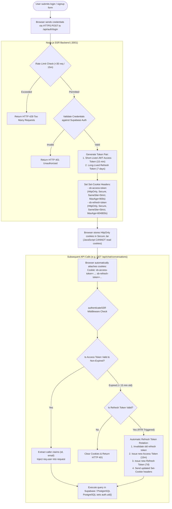
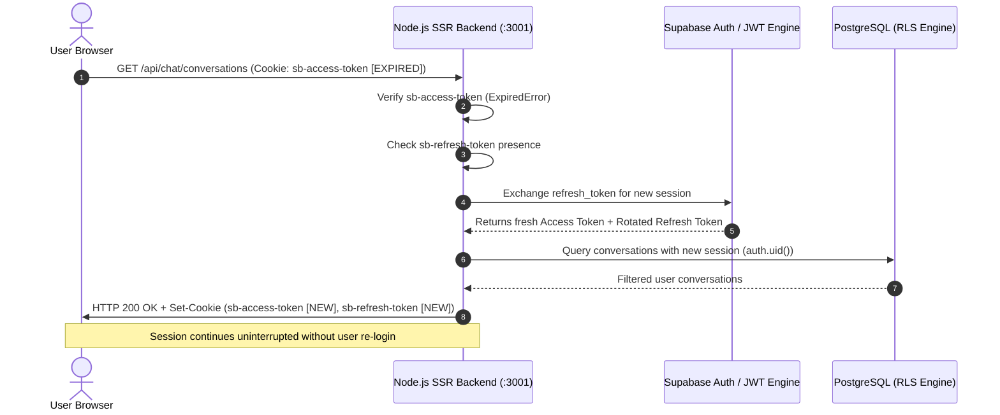

# Authentication & Session Security Workflow

This workflow details the **Server-Side Rendering (SSR) Authentication Pattern**, the **HttpOnly Cookie Mandate**, and the **Automatic Refresh Token Rotation (RTR)** architecture.

---

## 1. Authentication & Cookie Lifecycle Flowchart

---

## 2. Refresh Token Rotation (RTR) Sequence Diagram

---

## 3. Security Boundary Guarantees

| Security Property | Architectural Mechanism | Impact |
| :--- | :--- | :--- |
| **XSS Immunity** | `HttpOnly: true` on all authentication cookies | Malicious injected client scripts cannot access session tokens. |
| **CSRF Defense** | `SameSite: Strict` cookie flag | Cookies are only transmitted when requests originate from ChatLixy origin. |
| **Network Sniffing Defense** | `Secure: true` flag & TLS 1.3 | Cookies are never sent across unencrypted plaintext HTTP channels. |
| **Replay Attack Defense** | Refresh Token Rotation (RTR) | Used refresh tokens are immediately revoked; reuse attempts trigger instant session invalidation. |
