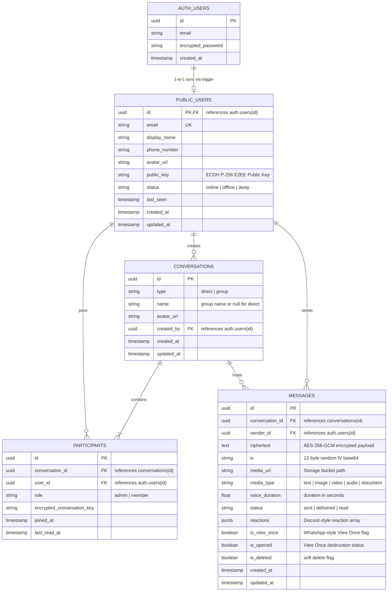

# Database Schema & Entity-Relationship Diagram (ERD)

This document provides the PostgreSQL relational model, schema constraints, and Row Level Security (RLS) enforcement rules for **ChatLixy**.

---

## 1. Entity-Relationship Diagram (ERD)

---

## 2. Row Level Security (RLS) Matrix

| Table | Policy Name | Permitted Roles | SQL Definition / Predicate |
| :--- | :--- | :--- | :--- |
| `public.users` | Authenticated users can view profiles | `authenticated` | `SELECT USING (true)` |
| `public.users` | Users can update their own profile | `authenticated` | `UPDATE USING (auth.uid() = id)` |
| `public.conversations` | Users can view conversations they participate in | `authenticated` | `SELECT USING (EXISTS (SELECT 1 FROM public.participants WHERE conversation_id = conversations.id AND user_id = auth.uid()))` |
| `public.conversations` | Authenticated users can create conversations | `authenticated` | `INSERT WITH CHECK (auth.uid() = created_by)` |
| `public.participants` | Users can view participants of their conversations | `authenticated` | `SELECT USING (EXISTS (SELECT 1 FROM public.participants p2 WHERE p2.conversation_id = participants.conversation_id AND p2.user_id = auth.uid()))` |
| **`public.messages`** | **Users can select messages only in participating conversations** | **`authenticated`** | **`SELECT USING (EXISTS (SELECT 1 FROM public.participants WHERE conversation_id = messages.conversation_id AND user_id = auth.uid()))`** |
| **`public.messages`** | **Users can insert messages only in participating conversations as themselves** | **`authenticated`** | **`INSERT WITH CHECK (auth.uid() = sender_id AND EXISTS (SELECT 1 FROM public.participants WHERE conversation_id = messages.conversation_id AND user_id = auth.uid()))`** |
| `public.messages` | Participants can update message receipts & reactions | `authenticated` | `UPDATE USING (EXISTS (SELECT 1 FROM public.participants WHERE conversation_id = messages.conversation_id AND user_id = auth.uid()))` |
