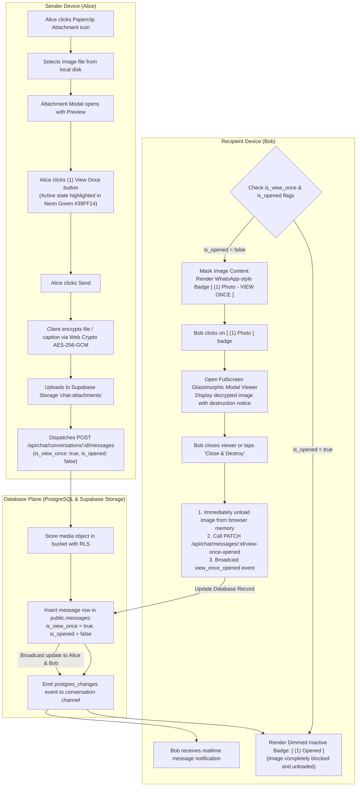
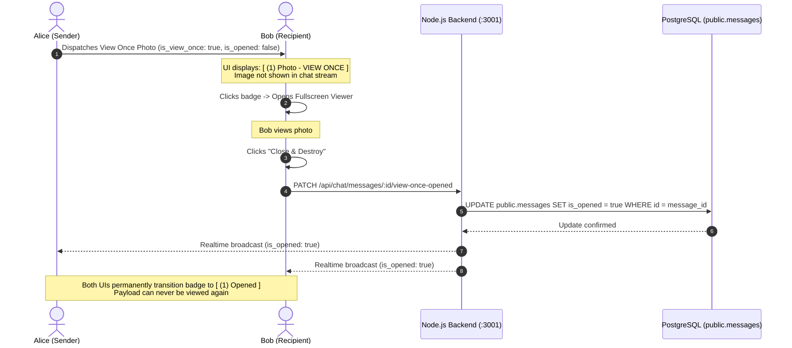

# Media Attachments & WhatsApp-Style "View Once" Workflow

This document details the lifecycle of encrypted media attachments and the **WhatsApp-Style View Once self-destructing photo mechanism**.

---

## 1. "View Once" Media Upload & Destruction Flowchart

---

## 2. Security Boundaries of View Once Media

