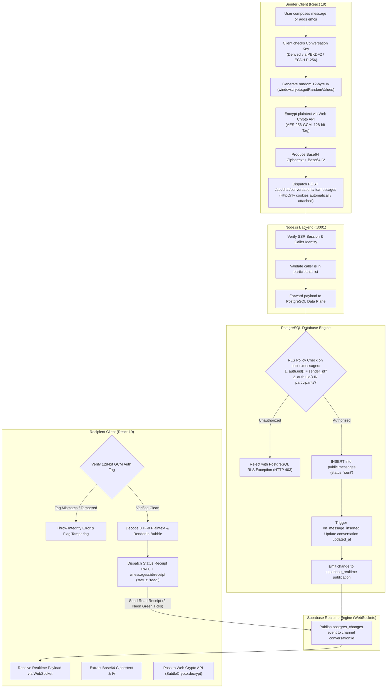
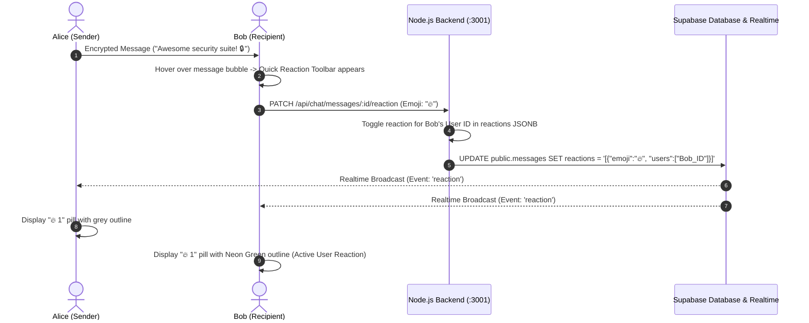
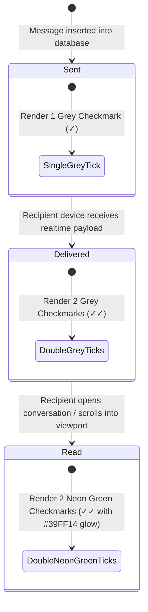

# Real-Time Messaging & End-to-End Encryption (E2EE) Workflow

This document details the cryptographic flow, PostgreSQL Row Level Security (RLS) enforcement, Supabase Realtime event streaming, and Discord-style reaction handling.

---

## 1. End-to-End Message Encryption & Delivery Flowchart

---

## 2. Discord-Style Message Reactions Workflow

---

## 3. Delivery Receipt Ticks State Machine

