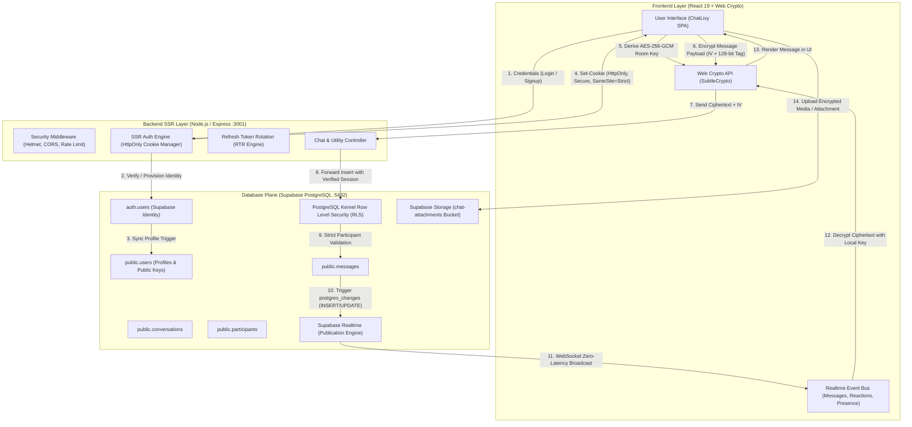

# ChatLixy Full-Stack Architecture & Workflow Guide

This directory documents the technical workflows, cryptographic pipelines, and data interactions between the **Frontend (React.js)**, **Backend Utility Server (Node.js SSR)**, and **Database / Realtime Plane (Supabase PostgreSQL & Storage)**.

---

## 1. Master System End-to-End Workflow

The diagram below illustrates the end-to-end data lifecycle across all three architectural layers:

---

## 2. Directory Index

Detailed domain-specific workflow diagrams are available in the following documents:

1. **[Authentication & Session Lifecycle (AUTH_WORKFLOW.md)](./AUTH_WORKFLOW.md)**  
   *Covers: SSR HttpOnly Cookie issuance, 15-minute Short-Lived JWT verification, Automated Refresh Token Rotation (RTR), and PostgreSQL Identity Binding.*

2. **[Real-Time Messaging & E2EE Pipeline (MESSAGING_REALTIME_WORKFLOW.md)](./MESSAGING_REALTIME_WORKFLOW.md)**  
   *Covers: Client Web Crypto AES-256-GCM encryption, PostgreSQL RLS participant validation, Supabase Realtime streaming, Discord-style emoji reactions, and receipt ticks.*

3. **[Media Attachments & WhatsApp-Style View Once (MEDIA_VIEW_ONCE_WORKFLOW.md)](./MEDIA_VIEW_ONCE_WORKFLOW.md)**  
   *Covers: File/Audio uploads to Storage, View Once photo masking, full-screen viewing session, and automatic post-view payload destruction.*

4. **[Database Schema & Entity Relationships (DATABASE_ERD.md)](./DATABASE_ERD.md)**  
   *Covers: PostgreSQL tables, relational constraints, foreign keys, and RLS security policies.*
